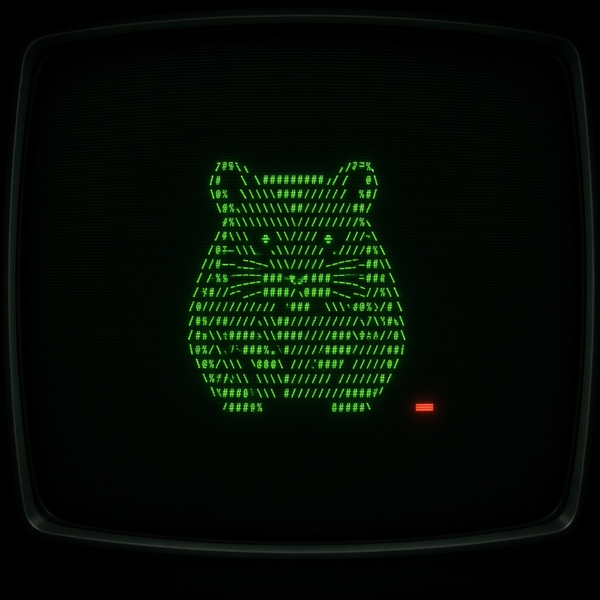
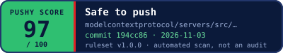

<p align="center">
  
</p>

<h1 align="center">Pushy</h1>

<p align="center"><strong>Pushy scans your AI skills before you force push them 🐹</strong></p>

<p align="center">
  <a href="https://forcepushcoin.github.io/score/"><strong>Open Pushy Score</strong></a>
  ·
  <a href="https://x.com/forcepushcoin">X</a>
  ·
  <a href="docs/RULES.md">Rules</a>
</p>

Pushy is the open-source home of the tools around [$FORCEPUSH](https://x.com/forcepushcoin). The first tool is **Pushy Score**: a client-side, rule-based risk scan for public GitHub repos of AI agent skills, prompt libraries, and MCP servers. You paste a repo URL. The page reads that repo from your browser, runs the rules in [`score/rules.js`](score/rules.js), and gives you a 0–100 score, the findings with file and line, and a README badge.

There is no account, no backend, and nothing is uploaded to Pushy. An optional GitHub token, if you paste one, stays in that tab and is sent only to `api.github.com` so you can get past the anonymous rate limit. That token is a GitHub credential. It is separate from the $FORCEPUSH coin.

<p align="center">
  
</p>

## What Pushy Score checks

Ruleset `pushy-rules` **1.0.0** (2026-11-03). **62 rules** in four categories. The full list of ids, severities, and descriptions is [docs/RULES.md](docs/RULES.md), generated from `score/rules.js`. The same table is rendered on the scan page.

### Secrets

Keys and credential files: AWS access keys, GitHub tokens, `sk-` style LLM and API keys, Slack / Stripe / other provider tokens, registry auth tokens, private key blocks, Google API keys, Telegram bot tokens, Slack webhook URLs, high-entropy secret assignments, wallet seed phrases and keypair paths, committed `.env` files, and committed key or credential files.

### Code & network

Shell and supply chain: a download piped into a shell, `eval` / `exec` / `new Function` / `pickle`, subprocess and shell spawning, destructive commands, obfuscated payloads and string construction, persistence (shell rc files, cron, launch agents, services, Run keys), reads of SSH keys and other credential stores, reverse shells, and `git push --force`.

Network: known paste, webhook, and tunnel hosts, a network call sitting next to environment variables or secret paths, raw IP URLs, and plain `http://` endpoints. The scan also lists external hosts it saw (`N005`, informational, penalty 0) and flags a long host list in code.

Permissions and packaging: unrestricted `allowed-tools` on a skill, agent settings that skip confirmations or auto-run commands, risky MCP launch config (shell `-c`, unpinned packages, privileged or host-mounted containers, remote plain `http`), `package.json` install scripts and non-registry dependencies, extra Python package indexes, GitHub Actions script injection and `pull_request_target` checkouts, committed binaries and archives, and a skill that ships scripts without `allowed-tools`.

### Prompt hygiene

Instruction text: override phrases, language that hides an action from the user, hidden `<IMPORTANT>` / `<system>` / `[SYSTEM]` blocks, HTML comments that carry instructions, instructions to read or send secrets, instructions that fetch remote text and follow it, instructions that send data to an outside party, tool-shadowing ("always call this first"), fake authority lines, and requests to skip permission prompts.

Hidden text: zero-width, bidi, and Unicode tag characters, long base64 or other opaque blobs, and padding (long runs of blank lines, spaces, or a huge single line).

### Docs & upkeep

`SKILL.md` frontmatter (`name` and `description`), a missing or tiny README, a README with no install or usage section, a missing license, a missing `SECURITY.md`, a missing repo description, an archived repo, a quiet commit history, a single recent author, a repo created in the last 14 days, and a fork.

## How a scan runs

1. **Pin a commit.** The page loads public repo metadata and the latest commit on the ref you named (the default branch when the URL has no branch). It lists the tree at that exact SHA.
2. **Pick files.** Up to **40** files, **200 KB** each. Priority goes to `SKILL.md`, `AGENTS.md`, `CLAUDE.md`, `.cursorrules`, MCP manifests, `package.json`, scripts, and prompt files. Skipped files are listed. A `/tree/<ref>/<folder>` URL scans that folder.
3. **Run the ruleset.** File bodies come from a SHA-pinned jsDelivr URL, then `raw.githubusercontent.com` if that fails. Rules are regexes and small functions in `rules.js`. Nothing is executed.
4. **Score, cap, and badge.** Four sub-scores become one number. Critical findings and gaps in coverage cap the score. You can download a static SVG badge stamped with the commit, the date, and the ruleset version.

A plain `owner/repo` scan makes three GitHub API calls: repository metadata, the commit list, and the git tree. File bodies are downloaded from jsDelivr or `raw.githubusercontent.com` and are not those API calls. Resolving a branch name, or walking a tree GitHub truncated, adds API calls. The page's rate-limit note rounds this to about four requests. Anonymous GitHub API access is 60 requests an hour per IP. A token with no scopes raises that to 5,000.

## How scoring works

Each category starts at 100. Findings subtract points from their category, then the four sub-scores are combined with fixed weights:

| Category | Weight |
| --- | --- |
| Secrets | 0.25 |
| Code & network | 0.30 |
| Prompt hygiene | 0.30 |
| Docs & upkeep | 0.15 |

Hits of one rule are ordered from highest severity to lowest. Hit number n costs that hit's own severity penalty times 1, 0.5, 0.25, then 0.1. The sum is capped at **1.75×** the penalty of the highest-severity hit. When every hit has the same severity, the costs are:

| Severity | First hit | 2nd | 3rd | Later |
| --- | --- | --- | --- | --- |
| critical | 45 | 22.5 | 11.25 | 4.5 |
| high | 22 | 11 | 5.5 | 2.2 |
| medium | 9 | 4.5 | 2.25 | 0.9 |
| low | 3 | 1.5 | 0.75 | 0.3 |
| info | 0 | 0 | 0 | 0 |

A category score is `max(0, round(100 − penalty))`. The raw score is the weighted sum of the four category scores, rounded. There is no bonus for green flags. License, `SECURITY.md`, CI, a lockfile, tests, Dependabot or Renovate, and `CODEOWNERS` are shown as "what looked good" and do not add points.

Caps then lower the raw score. The score becomes the lowest cap that applies.

| Condition | Cap |
| --- | --- |
| Any critical finding | 35 |
| Three or more high findings | 60 |
| Any high finding | 75 |
| GitHub truncated the file tree | 70 |
| More than half of scannable files were not analyzed | 70 |
| More than 20% of scannable files were not analyzed | 80 |
| At least one scannable file was not analyzed | 90 |
| A binary or archive is in the tree | 85 |
| Every analyzed file is a README, LICENSE, NOTICE, CONTRIBUTING, CHANGELOG, or SECURITY file, or nothing was analyzed | 60 |

One critical secret and clean other categories is a raw score of 89 (`55×0.25 + 100×0.75`), then the critical cap sets the score to **35**.

Bands, from the ruleset:

| Score | Verdict |
| --- | --- |
| 85–100 | Safe to push 🟢 |
| 70–84 | Push, but read the diff first 🟡 |
| 45–69 | Hmm. Review before you push 🟠 |
| 0–44 | Do NOT force push this 🔴 |

The on-page verdict keeps the emoji from `rules.js`. If almost nothing was analyzed, the verdict is replaced with "Nothing to scan here" and the score stays capped at 60. On a docs, example, or non-core README path, prompt and code findings drop one severity level before scoring. Test paths drop `X*` code rules one more level. Hidden-Unicode hits (`P011`) are not downgraded. Details are in [docs/RULES.md](docs/RULES.md#severity-on-a-hit).

## The badge

The badge is a **static snapshot** of one commit on one day. It is not a live shield. The SVG says "automated scan, not an audit" on it. After a scan, download `pushy-score.svg`, commit it at the root of the scanned repo, and use the markdown the page copies. With the deployed tool URL set, that markdown links the image back to the scanner:

```markdown
[](https://forcepushcoin.github.io/score/)
```

This picture is an example snapshot from ruleset 1.0.0 (score 97, commit `194cc86`, 2026-11-03). It is not a scan of this repository.

<p align="center">
  
</p>

Rescan after you push. The file you committed does not update itself.

## Run it

The live tool is [https://forcepushcoin.github.io/score/](https://forcepushcoin.github.io/score/).

To run this repo locally, serve the **repository root**. The page loads its logo from `../assets/logo.jpg`. Opening `score/index.html` as a file URL can block the GitHub requests the scan needs.

```bash
git clone https://github.com/forcepushcoin/pushy.git
cd pushy
python3 -m http.server 8000
```

Then open [http://127.0.0.1:8000/score/](http://127.0.0.1:8000/score/). No install and no build. The folder in [`score/`](score/README.md) is plain HTML, CSS, and JavaScript.

Node 18+ can load the engine for a rules check (`require('./score/pushy.js')`). See [CONTRIBUTING.md](CONTRIBUTING.md) for a working example.

## Tools

| Tool | Status |
| --- | --- |
| Pushy Score | Live |
| AI deep scan | Building |
| Commit Roast Card | Planned |
| Ship Log | Planned |
| Rescue | Planned |

## Limitations

Pushy Score is pattern matching on text. It is an automated scan, not an audit or a guarantee. It can be bypassed. A high score means none of these rules fired. It does not mean the repo is safe.

The ruleset's own blind spots:

- Paraphrased, translated, split-up, or obfuscated attacks can pass. Padding, bytecode, archives, and prompt-injected judges have been used to fool skill scanners. Pushy lists files it did not read and caps the score when coverage is incomplete. A cap is not a review.
- No language model and no person reads the instructions. Social engineering is caught only when a rule matches.
- Pages and docs a skill links to are never fetched. A clean file can point at instructions that change later.
- Binaries, archives, `.pyc` bytecode, office documents, and images are not opened.
- Only the files listed as analyzed were read, at most 40 files and 200 KB each.
- Dependencies are not scanned for known vulnerabilities or malware. Nothing is executed or sandboxed.
- One commit is read: the tip of the ref in the URL, or the default branch when you pass `owner/repo`. Other branches, tags, history, and later pushes are outside that result.

Read the code before you install or run a skill. The rules and the engine are in this repo so you can.

## Disclaimer

$FORCEPUSH is a meme coin with no intrinsic value. Using Pushy does not require the token, and paying never affects a score. Not financial advice.

Pushy Score is not affiliated with GitHub, Anthropic, or any scanner vendor.

## Repo map

| Path | What it is |
| --- | --- |
| [`score/`](score/) | Pushy Score v1. Open `index.html` via a local server. |
| [`assets/`](assets/) | Logo (`logo.jpg`) and the Pushy mascot (`pp.jpg`). |
| [`docs/RULES.md`](docs/RULES.md) | Every rule id, severity, category, and description. |
| [`CONTRIBUTING.md`](CONTRIBUTING.md) | How to add a rule, with a test and false-positive guidance. |
| [`SECURITY.md`](SECURITY.md) | How to report a vulnerability. |
| [`LICENSE`](LICENSE) | MIT, copyright 2026 forcepushcoin. |
